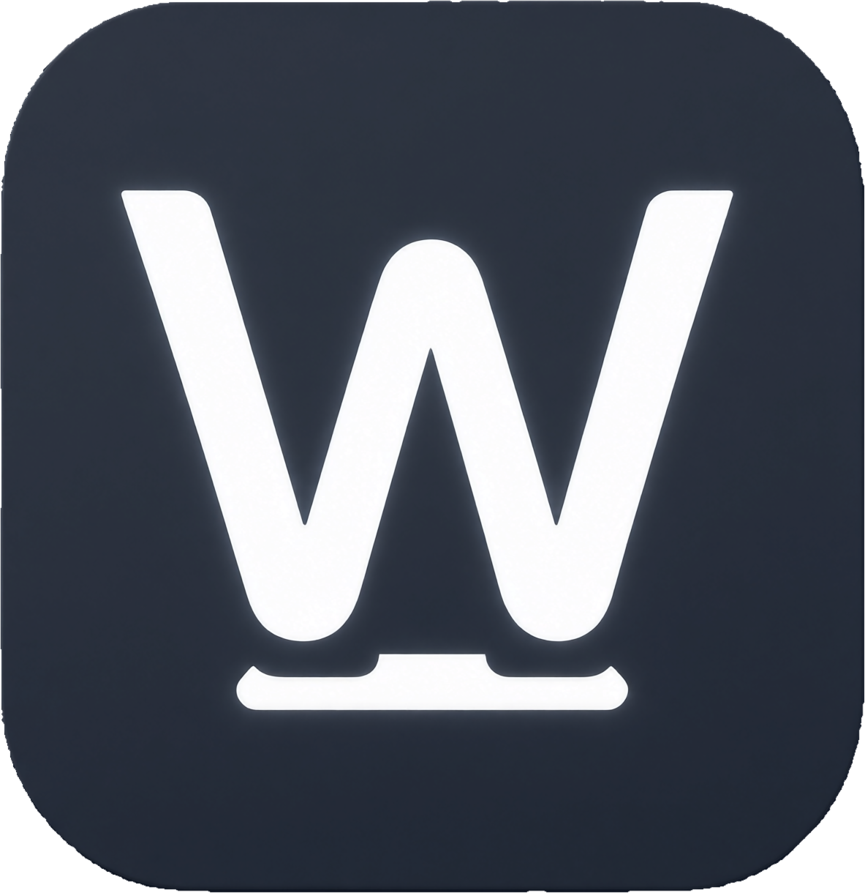

```markdown
<div align="center">
  
  <h1>WaltonDesk</h1>
  <p><strong>极简、极速、安全的新一代远程桌面控制软件</strong></p>

  
  
  
  
</div>

---

## 📖 简介 (Introduction)

**WaltonDesk**（原名 `rdc`）是一款主打“低延迟、高画质”的个人开源远程桌面软件。经历了从底层协议到前端 UI 的史诗级重构，v5.0.0 版本全面拥抱现代异步架构与 H.264 视频流技术。

无论是在局域网内进行远程办公，还是为家人提供远程技术支持，WaltonDesk 都能提供近乎本地操作的流畅体验。

## 📸 界面预览 (Screenshots)

<div align="center">
  
  &nbsp;&nbsp;
  
</div>

<br/>

## ✨ 核心特性 (Features)

- 🚀 **全帧 H.264 视频流**：告别传统的 JPEG 刷屏，基于 PyAV 实现超高压缩比，带宽节省高达 94%，画面丝滑流畅。
- ⚡ **纯异步底层架构**：基于 `asyncio` 重写，彻底解决传统多线程架构的队头阻塞与死锁。
- 🔒 **企业级安全防护**：全链路 TLS 1.2+ 加密，TOFU 指纹校验，HMAC-SHA256 完整性校验，首次启动自动生成随机强密码。
- 🖥️ **原生 Qt 体验**：深色模式，原生高 DPI 支持，屏幕动态分辨率无缝跟随（等比居中无拉伸）。
- 🛡️ **智能防爆破与审计**：内置防口令爆破封禁、完整的结构化审计日志（明文密码绝不落盘）。
- 🖱️ **完美外设穿透**：支持复杂组合键、鼠标横向滚轮、Win 键防死锁应急机制。
- ⚙️ **极简开机自启**：支持一键静默启动至托盘待命，随时接受主控端连入。

## 📦 安装与使用 (Quick Start)

### 普通用户（推荐）
请前往右侧的 [**Releases**](https://github.com/WaltonVesta/WaltonDesk/releases) 页面，下载最新的 `WaltonDesk_setup.exe` 并双击安装。

> 安装包支持自定义路径、桌面快捷方式、以及**可选**的开机自启（默认不勾选，保障安全）。

**首次启动必看：** 被控端初次运行会自动生成一个 8 位随机强密码，并在**控制台、托盘气泡、弹窗**三处同时高亮显示。请记录该密码，连接成功后建议立即在托盘菜单中修改。

### 开发者（源码运行）
本项目使用 [uv](https://github.com/astral-sh/uv) 进行依赖管理，需 Python 3.14+。

```bash
# 1. 克隆仓库
git clone https://github.com/WaltonVesta/WaltonDesk.git
cd WaltonDesk

# 2. 安装依赖
uv sync --all-groups

# 3. 生成 Protobuf 代码
uv run python scripts/gen_proto.py

# 4. 启动图形界面
uv run python -m rdc --gui

## 🏗️ 技术栈 (Tech Stack)

- **UI 交互**: PySide6 (Qt 6.11) + qasync
- **网络传输**: asyncio + TLS 1.2+ + IPv4/IPv6 双栈
- **协议序列化**: Protobuf + HMAC-SHA256
- **屏幕采集与编码**: mss + PyAV (FFmpeg, libx264)
- **系统底层**: ctypes (Win32 SendInput)

## ⚠️ 已知限制 (v5.0.0)

受限于 Windows 系统级安全边界（普通用户权限），v5.0.0 暂不支持：
1. **安全桌面操作**：无法查看或操作 UAC 提权弹窗、锁屏界面。当远端进入安全桌面时，画面会自动暂停。
2. **完整 Win 键转发**：系统会截获 Win 键，导致主控端无法直接远程呼出开始菜单（v5.0.0 已加入 2 秒防死锁机制）。

> *突破上述限制（系统服务化 + 底层键盘钩子 + 签名）将在 v5.1.0 特权操作版本中提供。*

## 🤝 贡献与反馈

欢迎提交 Issue 反馈 Bug 或提出功能建议。
提交代码前，请确保本地测试全绿：`uv run pytest tests -q`。

## 📄 开源协议

本项目采用 [MIT License](LICENSE) 开源协议。
```
